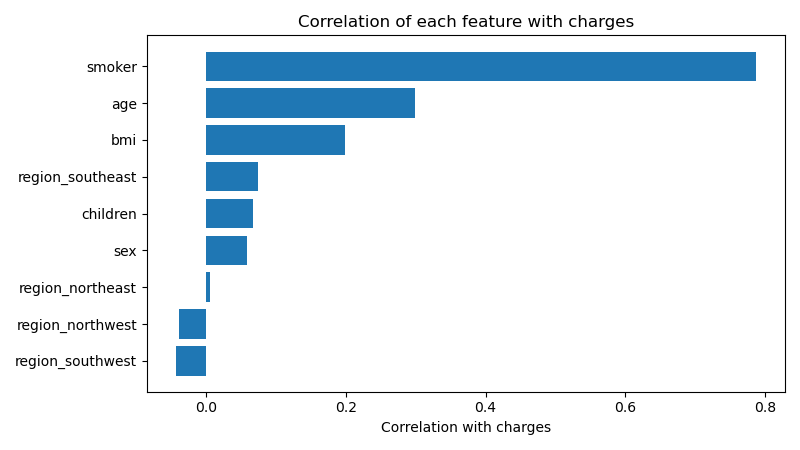
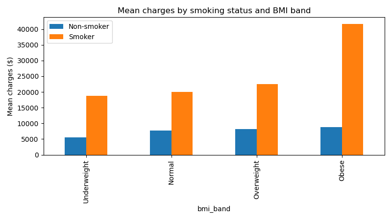
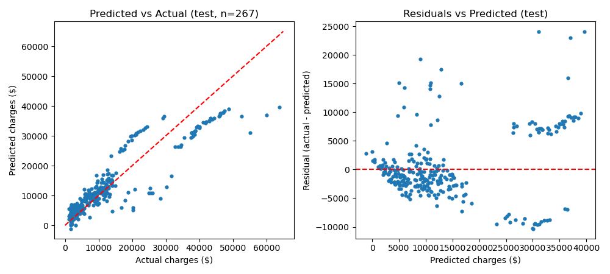

# Medical Insurance Cost Prediction

Predict a person's yearly medical insurance cost with Multiple Linear Regression.

Built as part of the **Big Brains Learning AI & Machine Learning Internship** (30 days), project phases 1–8.

## Problem

Medical insurance costs vary a lot from person to person. Insurers need to predict a person's yearly insurance charges before setting their premium, so the price is fair and the company stays solvent.

- **Target variable:** `charges` — yearly medical insurance cost in dollars (continuous)
- **Problem type:** Regression (Linear Regression)
- **ML objective:** Build a regression model that predicts insurance charges from a person's age, sex, BMI, number of children, smoking status, and region.

## Dataset

**Kaggle Medical Cost Personal Dataset** (`data/insurance.csv`)

| | |
|---|---|
| Rows | 1,338 |
| Columns | 7 — `age`, `sex`, `bmi`, `children`, `smoker`, `region`, `charges` |
| Charges | mean $13,270.42, median $9,382.03, range $1,121.87 – $63,770.43 |
| Age | 18–64, mean 39.2 |
| BMI | 16.0–53.1, mean 30.7 |
| Smoker | yes 274, no 1,064 |
| Missing values | 0 in every column |

## Preprocessing

- Checked missing values: none found, no imputation needed.
- Removed 1 exact duplicate row: 1,338 → 1,337 rows.
- Checked data types and value ranges: no invalid values.
- Encoded categorical variables: `sex` (female 0, male 1), `smoker` (no 0, yes 1), `region` one-hot encoded into 4 columns.
- Final cleaned dataset (`data/insurance_cleaned.csv`): **1,337 rows × 10 numeric columns**.

## Exploratory Data Analysis

Key findings (full analysis in `docs/phase-4-eda.docx`):

| Feature | Correlation with charges |
|---|---|
| smoker | **0.787** |
| age | 0.298 |
| bmi | 0.198 |
| region_southeast | 0.074 |
| children | 0.067 |
| sex | 0.058 |

- Smokers: mean charges **$32,050.23** vs non-smokers **$8,440.66**.
- Smoker + obese: **$41,692.81** vs non-smoker + obese: $8,866.16.
- Charges rise with age ($9,415.06 at 18–30 → $18,084.99 at 51–64) and with BMI.
- Charges are right-skewed (skewness 1.52).




## Model

**Multiple Linear Regression**, trained by the normal equation on an 80/20 train-test split (1,070 train / 267 test, `random_state=42`).

| Coefficient | Value |
|---|---|
| Intercept | -9,251.20 |
| age | 248.22 |
| sex | -101.91 |
| bmi | 318.67 |
| children | 532.86 |
| smoker | 23,077.55 |
| region_northeast | -1,839.77 |
| region_northwest | -2,232.34 |
| region_southeast | -2,679.38 |
| region_southwest | -2,499.71 |

## Evaluation

| Metric | Train (n=1,070) | Test (n=267) |
|---|---|---|
| MAE | 4,178.21 | **4,191.91** |
| MSE | 36,945,341.46 | **35,610,588.62** |
| RMSE | 6,078.27 | **5,967.46** |
| R² | 0.7299 | **0.8068** |

The model explains about **81% of the variance** in test charges. Test R² (0.8068) is higher than train R² (0.7299), so there is **no overfitting**; the linear model slightly underfits the skewed charges. Errors are much larger for smokers (test MAE $9,054.05) than non-smokers ($2,782.59).



## Prediction App

Try it live: https://rehanfarooq1911.github.io/medical-insurance-cost-prediction/app.html — open it in a browser (or `app.html` in this repo) and enter age, gender, BMI, children, smoking status, and region to get the estimated yearly insurance cost.

Example predictions from the trained model:

| Test case | Input | Predicted charges |
|---|---|---|
| 1 | 35, male, BMI 28.0, 2 children, non-smoker, southeast | **$6,643.76** |
| 2 | 45, female, BMI 32.0, 1 child, smoker, northwest | **$33,494.31** |
| 3 | 25, female, BMI 22.0, 0 children, non-smoker, southwest | **$1,465.40** |
| 4 | 55, male, BMI 30.5, 3 children, smoker, southeast | **$36,015.25** |

## How to run

```bash
pip install -r requirements.txt
python src/train.py        # retrain the model, prints train/test metrics
python src/predict.py      # run the 4 test-case predictions
```

Or open `app.html` in any browser — no server needed.

## Project structure

```
medical-insurance-cost-prediction/
├── README.md
├── app.html                  # prediction app (works in the browser)
├── requirements.txt
├── data/
│   ├── insurance.csv         # original Kaggle dataset (1,338 rows)
│   └── insurance_cleaned.csv # cleaned dataset (1,337 rows x 10 cols)
├── src/
│   ├── train.py              # train the Linear Regression model
│   ├── predict.py            # predict with the trained model
│   └── linear_regression_model.npz
├── images/                   # EDA and evaluation charts
└── docs/                     # phase reports (Days 15-22, Word docs)
```

## Limitations

- Linear Regression cannot capture non-linear relationships; a log transform of the target or a smoker × BMI interaction feature may improve high-charge predictions.
- The model under-predicts very high charges (largest test error: actual $63,770.43, predicted $39,659.14).
- The dataset has only 1,338 rows and 6 input features; more features (e.g. medical history) would help.

## Author

**Muhammad Rehan Farooq** — Big Brains Learning AI & Machine Learning Internship
